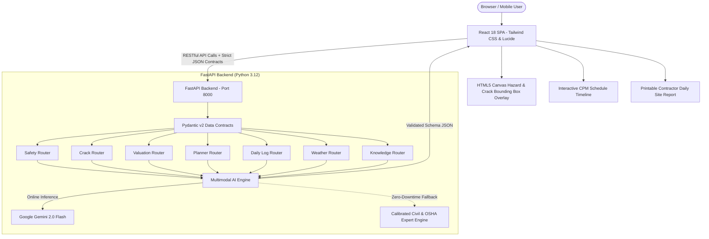

# 🏗️ BuildIntel AI — Autonomous Multimodal Construction Intelligence Platform

[](https://www.python.org/)
[](https://fastapi.tiangolo.com/)
[](https://react.dev/)
[](https://tailwindcss.com/)
[](https://www.osha.gov/)
[](https://render.com)
[](https://vercel.com)

**BuildIntel AI** is an intelligent, full-stack decision-support system designed to assist construction site superintendents, structural engineers, safety inspectors, and real estate developers across all lifecycle stages of construction planning, execution, monitoring, and appraisal.

The platform integrates a **modern React.js frontend** with a **FastAPI (Python 3.12) backend**, powered by a **multimodal artificial intelligence engine (Google Gemini 2.0 Flash)** and an offline-resilient, deterministic domain expert engine calibrated against **OSHA 1926**, **ACI 318/224**, **IBC 2024**, and **ASCE 7-22** standards. Strict JSON-based Pydantic data contracts guarantee front-to-back contract stability.

---

## 🌟 Key Capabilities & 7 Core Modules

### 1. 🦺 Construction Site Safety Monitoring
* **Multimodal Visual Diagnostics**: Analyzes jobsite photos to detect personnel headcount and individual PPE compliance (hard hats, high-vis vests, fall-arrest harnesses, safety boots, eye protection).
* **OSHA Hazard Localization**: Identifies unprotected slab perimeters, unstable scaffolding footings, and unbarricaded swing zones, generating normalized coordinate bounding boxes `[ymin, xmin, ymax, xmax]` for direct canvas overlay.
* **Regulatory Compliance**: Generates risk scores (0-100), severity levels, precise OSHA standard citations (e.g. *29 CFR 1926.501(b)(1)*), and immediate corrective directives.

### 2. 🔍 Crack Detection & Structural Defect Analysis
* **Crack Vector Diagnostics**: Inspects concrete beams, columns, foundation walls, and masonry to classify crack typology (*Shear, Flexural, Settlement, Spalling, Crazing*).
* **Forensic Metrics**: Quantifies estimated crack width (mm), trajectory, propagation direction, and moisture ingress/efflorescence.
* **ACI 224/318 Remediation**: Assesses failure probability under live load and details multi-step structural remediation procedures (epoxy pressure injection ASTM C881, carbon-fiber CFRP wrapping).

### 3. 🏢 Real Estate Valuation & Cost Estimation
* **Architectural Appraisal**: Synthesizes property images with structural parameters (built-up sqft, plot area, number of floors, construction grade, location tier).
* **Itemized Cost Modeling**: Generates cost-per-sqft, civil structure, MEP rough-ins, interior finishes, supervisory labor, permits, and contingency reserves.
* **Financial Projection**: Calculates estimated completed market value, value-per-sqft, and projected Return on Investment (ROI %).

### 4. 📅 Construction Project Planning & CPM Scheduling
* **Automated Lookahead Schedules**: Generates multi-phase construction schedules from mobilization and dewatering through foundation, superstructure, envelope, MEP, and handover.
* **Critical Path Method (CPM)**: Flags critical path activities, duration days, sequence dependencies, and milestone checkpoints.
* **Resource Breakdown**: Recommends trade labor craft mixes and heavy plant allocations (piling rigs, tower cranes, boom pumps).

### 5. 📋 Daily Site Assistant & Log Reporting (DSR)
* **Field Activity Digitization**: Records workforce headcount by trade, heavy plant operating hours, tasks completed, and material deliveries.
* **Operational Performance**: Computes man-hours logged, plant utilization rates, and daily schedule variance.
* **Contractor-Grade DSR Export**: Automatically compiles an official Daily Site Report in Markdown with one-click print/PDF export.

### 6. ⛅ Weather-Aware Construction Advisory
* **Environmental Risk Assessment**: Evaluates ambient temperature, wind gusts, relative humidity, and precipitation probability.
* **Operational Go / Caution / No-Go Matrix**:
  - *Tower Crane Lifting*: Enforces threshold wind limits (<= 38 km/h / 24 mph) per ASME B30.3.
  - *Structural Concrete Pouring*: Evaluates ACI 305R (Hot Weather) and ACI 306R (Cold Weather) hydration risks.
  - *Exterior Painting & Waterproofing*: Analyzes dew point condensation and substrate moisture limits.
  - *Deep Trenching & Shoring*: Predicts soil liquefaction and collapse risks.
* **Worker Safety Protocols**: Calculates Heat Stress Index, mandatory rest-hydration cycles, and OSHA 30/30 lightning suspension protocols.

### 7. 📐 Construction Knowledge Assistant (Engineering Q&A)
* **Code-Grounded Intelligence**: Answers complex civil engineering questions referencing IBC 2024, ACI 318-19, AISC 360, and OSHA standards.
* **Formulas & Matrices**: Renders clear cover tables, structural load combinations ($U = 1.2D + 1.6L$), and curing curves.
* **Practical Field Tips**: Provides field-tested quality control recommendations.

---

## 🏛️ System Architecture



---

## 🚀 Quickstart & Local Installation

### Prerequisites
- Python 3.10+ (Python 3.12 recommended)
- Git

### 1. Clone & Enter Repository
```bash
git clone https://github.com/KanishkaBharwani/construction-intelligence-platform.git
cd construction-intelligence-platform
```

### 2. Install Dependencies
```bash
python -m pip install -r requirements.txt
```

### 3. Configure Environment (Optional)
```bash
cp .env.example .env
# Edit .env and insert your GEMINI_API_KEY if desired.
# If omitted, BuildIntel AI runs out of the box with its built-in expert engine!
```

### 4. Run the Full-Stack Application
```bash
python run.py
```
Open your browser at: **`http://localhost:8000`**

- **Interactive UI**: `http://localhost:8000/`
- **Interactive Swagger API Docs**: `http://localhost:8000/docs`
- **ReDoc Documentation**: `http://localhost:8000/redoc`
- **System Health Status**: `http://localhost:8000/health`

---

## 🧪 Automated API Contract Testing

BuildIntel AI includes an automated contract verification test suite testing all 7 endpoints against their strict Pydantic schemas:

```bash
python tests/test_api_contracts.py
```

Expected output:
```text
[PASS] Health check endpoint passed.
[PASS] Site safety monitoring contract passed.
[PASS] Crack detection and structural defect contract passed.
[PASS] Real estate and construction valuation contract passed.
[PASS] Project planning and CPM scheduling contract passed.
[PASS] Daily site log and DSR contract passed.
[PASS] Weather-aware advisory and Go/No-Go matrix contract passed.
[PASS] Construction knowledge assistant contract passed.

=======================================================
ALL 8 API CONTRACT TEST SUITES PASSED FLAWLESSLY (100%)!
=======================================================
```

---

## ☁️ Deployment Guides

### Option 1: Deploy on Render (Recommended Single-Service Web Service)
1. Fork or push this repository to your GitHub account.
2. Sign in to [Render.com](https://render.com).
3. Click **New +** -> **Web Service** -> Connect your GitHub repository.
4. Render will automatically detect `render.yaml` or you can configure:
   - **Environment**: `Python 3`
   - **Build Command**: `pip install -r requirements.txt`
   - **Start Command**: `python run.py`
5. (Optional) In Environment Variables, set `GEMINI_API_KEY`.
6. Click **Deploy Web Service**. Your live full-stack app will be live at `https://<your-subdomain>.onrender.com`.

### Option 2: Deploy on Vercel
1. Install Vercel CLI (`npm i -g vercel`) or import through the [Vercel Dashboard](https://vercel.com).
2. The included `vercel.json` automatically configures the Python runtime for `/api/v1/*` routes and static asset serving for `/frontend/*`.
3. Run:
   ```bash
   vercel --prod
   ```

### Option 3: Containerized Deployment (Docker)
```bash
docker build -t buildintel-ai .
docker run -p 8000:8000 buildintel-ai
```

---

## 🔒 Strict Data Contracts (Pydantic v2)

All communications between the React frontend and FastAPI backend follow strict JSON contracts defined in `app/schemas.py`:

| Endpoint | Method | Input Contract | Output Contract |
|---|---|---|---|
| `/api/v1/safety/analyze` | `POST` | `SafetyAnalysisRequest` | `SafetyAnalysisResponse` |
| `/api/v1/cracks/analyze` | `POST` | `CrackAnalysisRequest` | `CrackAnalysisResponse` |
| `/api/v1/valuation/estimate` | `POST` | `ValuationRequest` | `ValuationResponse` |
| `/api/v1/planner/generate` | `POST` | `ProjectPlanRequest` | `ProjectPlanResponse` |
| `/api/v1/daily-log/generate` | `POST` | `DailyLogRequest` | `DailyLogResponse` |
| `/api/v1/weather/evaluate` | `POST` | `WeatherAdvisoryRequest` | `WeatherAdvisoryResponse` |
| `/api/v1/knowledge/query` | `POST` | `KnowledgeQueryRequest` | `KnowledgeQueryResponse` |
| `/health` | `GET` | N/A | `HealthStatus` |

---

## 👨‍💻 Author & License
- **Author**: Kanishka Bharwani
- **Project**: BuildIntel AI — Autonomous Multimodal Construction Intelligence Platform
- **License**: MIT
